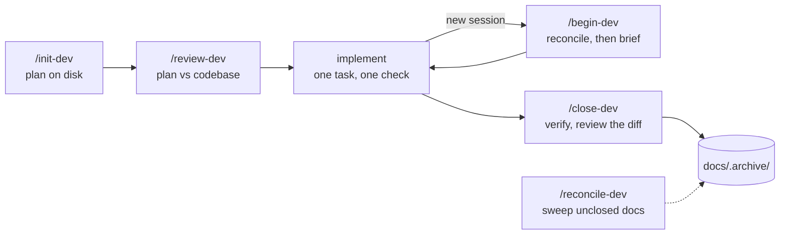

# claude-dev-loop

[](https://github.com/rfung4/claude-dev-loop/actions/workflows/test.yml)
[](LICENSE)
[](https://code.claude.com)

**Plan on disk, check the plan against the code, resume cleanly, close against the plan.**

A documentation-driven development loop for [Claude Code](https://code.claude.com): slash
commands that plan a change, gate the plan against the real codebase, resume it in a fresh
session, and close it out by reviewing the diff. The plan is written first and drives the
work. It lives in `docs/development/{feature}/`, every task carries a runnable `Verify:` line
written at plan time, and state survives `/clear`, compaction and model switches because it is
in files and git, not in the conversation.

It is built for long, multi-session work in repos you don't own, where the agent loses context
and a plausible-wrong change is expensive.



**In use:** first written in January 2026; the four loop commands ran 544 times across 11
repositories in the five weeks the session logs cover (2026-08-29 to 2026-10-02). The specs
record the field audits run against those logs; most of what they changed was removal.

## Why not plan mode, Spec Kit or Kiro?

| | Claude Code plan mode | Spec Kit / Kiro | This loop |
|---|---|---|---|
| Where the plan lives | A scratch file outside the repo by default | Spec files committed to the repo | `docs/development/{feature}/`, in the repo but gitignored, so it works in repos you don't own |
| What the plan is checked against | Your own read of it | The other spec artifacts (Spec Kit's `/analyze`) | The codebase, in a fresh context: each cited `file:line` opened, each "nothing else calls this" grepped |
| Ceremony for small work | Light | A full spec set (one review saw Kiro turn a bug fix into 4 stories and 16 acceptance criteria) | `--light` is one SPEC.md; a diff that fits in one sentence gets no plan |

## Install

Needs Claude Code and bash. Clone anywhere, then link:

```bash
git clone https://github.com/rfung4/claude-dev-loop.git
cd claude-dev-loop && ./install.sh
```

`install.sh` creates three kinds of symlink and nothing else:

| Link | Points at | Why |
|---|---|---|
| `~/.claude/commands/{init,review,begin,close,reconcile}-dev.md` | `commands/` | makes the commands invocable in every repo |
| `~/.local/bin/setup-docs` | `scripts/setup-docs.sh` | scaffolds `docs/` in a project |
| `~/.claude/claude-dev-loop` | this clone | the fixed prefix the commands use to `Read` their specs, context and templates from inside any project |

It never replaces an existing regular file. `./install.sh --uninstall` removes exactly those
links. Then, in a project:

```bash
setup-docs . "My Project"
```

That creates `docs/` with six INDEX files (four in tracked hubs, two in the local-only
`research/` and `development/`), gitignores `docs/{research,development,report,.archive}/`,
and installs a local pre-commit hook that stops those local-only docs from being committed.

## The commands

| Command | When | What it does |
|---|---|---|
| [`/init-dev`](commands/init-dev.md) `<feature> [--light]` | A decision is made and the change is more than one sentence | Reads the codebase, asks only the questions whose answers change a task, then writes `docs/development/{feature}/SPEC.md`: tasks with a `Verify:` each, acceptance criteria, one end-to-end check. Full mode adds INDEX and PROGRESS |
| [`/review-dev`](commands/review-dev.md) `<feature>` | After planning, before any code | Verifies the plan's claims against the repo in a fresh context. No report file and no verdict line: the Blockers list is the verdict, and on your go-ahead the findings are folded into SPEC.md where they apply |
| [`/begin-dev`](commands/begin-dev.md) `[feature]` | Returning to work, or leaving a cluttered session | Reconciles what the doc claims against what the repo shows; in handoff mode writes back evidenced corrections. Then briefs inline, or writes a self-contained `/tmp` handoff file for a fresh session |
| [`/close-dev`](commands/close-dev.md) `<feature>` | Every task's `Verify:` passes, before the PR | Reruns every check, reviews the branch diff in a fresh context, lists files changed outside the plan, promotes deliverables into `docs/`, writes `docs/report/{feature}.md`, archives the dev doc |
| [`/reconcile-dev`](commands/reconcile-dev.md) `[--dry-run]` | Dev docs have piled up: features shipped unclosed, plans went quiet | One read-only subagent per quiet doc checks it against git. Shipped and superseded docs move to `docs/.archive/` on one go-ahead; stalled and never-started ones get one question each (archive, park, keep). Fresh docs are not read |

`--light` (SPEC.md only) is the normal case. Full structure has to be earned: the work spans
sessions, or it produces a document worth promoting. If the diff fits in one sentence, don't
plan at all.

## Agent patterns in here

The commands are prompts, so the engineering is in how they use the agent. Each of these is a
rule in a file you can read:

| Pattern | Where | What it looks like |
|---|---|---|
| Fresh-context review | [`review-dev`](commands/review-dev.md) | The session that wrote a plan never grades it. The review runs in a subagent or a new session, on a pinned model, and must cite the repo |
| Orchestrator with read-only fan-out | [`reconcile-dev`](commands/reconcile-dev.md) | One subagent per doc, a fixed reply shape, and the orchestrator re-checks every cited commit before it trusts an archive verdict |
| State on disk, not in context | [`begin-dev`](commands/begin-dev.md) | A fresh session rebuilds from the dev doc and git. Write-back takes code, a commit or the diff as evidence; session recollection is not evidence |
| Checks written by the planner | [`init-dev`](commands/init-dev.md) | `Verify:` is a command or a named test file, never prose, so "done" is something a later session can run |
| Routing by verifiability | [`context-agentic`](context/context-agentic.md) | Tasks run on the session's model. A `Route:` line marks the exception: work whose check can test shape but not correctness goes to the strongest model |
| Human gates on irreversible steps | [`begin-dev`](commands/begin-dev.md) | A bare "go" never authorises a prod, deploy or destructive step; only the phrase the briefing names does |
| Context loaded on demand | [`review-dev`](commands/review-dev.md) | Commands carry text pointers and `Read` a rule file only when the plan triggers it. Nothing is `@`-included |

## Design rules

Most were learned by something failing quietly.

- **`Verify:` is the routing key.** Every task carries a command or a named test file, written
  by the planner. In the studies reviewed, supplied checks moved agent success rates and
  agent-written ones didn't. The same line decides where the strongest model is spent: a
  runnable check lets the session's model iterate against it, and no runnable check means
  nothing downstream will catch a plausible-wrong answer.
- **`@`-include is eager.** `@path` in a command or CLAUDE.md loads the file every time,
  unconditionally — a condition written beside it does nothing, and a code fence doesn't stop
  it. The commands use plain-text pointers and let the model `Read` what the work triggers.
- **A trailing `/command` is a no-op.** Slash commands only fire as the first token of a
  prompt. "…then run /review-dev" mid-sentence silently does nothing, so `/init-dev` ends by
  printing `Next: /review-dev …` for the human to run rather than trying to chain into it.
- **Archive before delete.** `docs/development/` is gitignored, so an overwrite is
  unrecoverable. `--refresh` copies SPEC.md to `docs/.archive/{timestamp}/` before rewriting;
  `/close-dev` and `/reconcile-dev` move the whole dev doc there.
- **Fresh context for review, evidence over prose.** A session grading its own plan favours its
  own reasoning. Reviews run in a subagent or a session that didn't write the plan, and must
  cite the repo.

## Measured, then cut

The loop is tuned on its own usage logs, and the specs record what each audit found. Most of
the findings ended in something being removed:

| Finding | Change | Recorded in |
|---|---|---|
| The first review said Blocked in 70 of 71 features | The verdict line was removed; the Blockers list is the verdict | [`specs/review-dev.md`](specs/review-dev.md) |
| The same model wrote and reviewed 68 of 78 plans | The review command pins its own model, so the common case is no longer a model grading itself | [`specs/review-dev.md`](specs/review-dev.md) |
| A plan-compliance subagent stopped nothing in 31 runs | Replaced by a fresh-context review of the diff | [`commands/close-dev.md`](commands/close-dev.md) |
| About half of all tasks were routed to Sonnet, which got 0.4% of spend | Per-task routing was dropped; a task runs on the session's model | [`context/context-agentic.md`](context/context-agentic.md) |
| 1 of 94 handoff files was written unprompted | Handoffs are started by the human, never suggested by the model | [`specs/begin-dev.md`](specs/begin-dev.md) |
| The median SPEC was 41 KB against a 10 KB guideline nothing enforced | Size is checked at planning time, after the codebase look | [`specs/init-dev.md`](specs/init-dev.md) |
| The context library restated what the model already knows | Cut from 1,650 lines to 310, read a section at a time | [`docs/why.md`](docs/why.md) |
| 182 dev docs were open across the repos using the loop, 123 of them stale | `/reconcile-dev` sweeps them: archive, park or keep | [`specs/reconcile-dev.md`](specs/reconcile-dev.md) |

## What it looks like

Illustrative output, in the shape each command's file defines.

<details>
<summary><b>/init-dev</b> asks only the questions whose answers change a task, each with a recommendation</summary>

```
> /init-dev user-preferences

Analyzing context...
Found: JSON column decision, models/user.py, api/preferences.py

Analyzing codebase...

2 branches. Answer, or press enter to take the recommendation.

[1/2] Existing rows have no preferences value — backfill or default-on-read?
      → Recommend: default-on-read. 40k rows, column is nullable, and a
        data migration blocks later deploys if it fails.
> enter

[2/2] Validate keys against a schema, or store free-form JSON?
      → Recommend: free-form for now, listed under Out of scope. No caller
        needs validation yet and it is additive later.
> free-form, agreed

Created: development/user-preferences/
  - INDEX.md (populated)
  - SPEC.md (6 tasks, each with Verify:; task 3 · keystone; 2 Decisions)
  - PROGRESS.md

Next: /review-dev user-preferences
```

</details>

<details>
<summary><b>/review-dev</b> checks the plan's claims against the repo before judging anything</summary>

```
# Development Review: user-preferences

**Focus:** all
**Context read:** none

## Claim verification
- models/user.py:45 "preferences column is nullable" → verified (nullable=True)
- "only api/preferences.py reads preferences" → wrong: also jobs/export.py:112

## Blockers
### 1. Export job not covered
- **Location:** `SPEC.md:Task 3`
- **Issue / Impact / Required:** export reads the raw column; default-on-read
  never reaches it. Add a task, or move the default into the model.

## Security
N/A — no auth, input or migration surface

## Recommendation
Fix Blocker 1, then proceed.
```

A wrong claim is a Blocker however good the rest of the plan is. An empty Blockers list means
proceed.

</details>

<details>
<summary><b>/begin-dev</b> reconciles the doc against the repo, then names the next session's model</summary>

```
> /begin-dev        (mid-session → handoff)

Inferring dev doc... branch `feat/user-preferences` → docs/development/user-preferences/
Reconciling plan vs repo...

Readiness: Gaps found (Task 4 checkbox drift; working tree clean)

Written to dev doc:
  SPEC.md   task 4 [x] → [ ]   no code at src/limits.py (claimed done)
  PROGRESS  + log entry 2026-07-06

/tmp/begin-dev-user-preferences-20260706_142210.md
Paste the path into a fresh session, then /clear.

Next: opus · medium — you are on opus: new session: claude --model opus --effort medium
```

</details>

<details>
<summary><b>/close-dev</b> reruns the checks and reviews the diff in a fresh context</summary>

```
> /close-dev user-preferences

Found: development/user-preferences/ (2 deliverables)

Pre-flight... ✓
Verify (6 tasks + e2e)... ✓
Code review (high)... 0 findings; 1 file outside plan: src/utils/fmt.py (noted)

Promoting:
  ✓ design.md → architecture/user-prefs.md
  ✓ api-changes.md → api/users.md

Report: docs/report/user-preferences.md
Archived: docs/.archive/20260106_143022/
```

</details>

<details>
<summary><b>/reconcile-dev</b> sorts the pile by who can decide: the repo, or you</summary>

```
> /reconcile-dev

docs/development/: 14 entries — 4 fresh, 1 parked, 1 not a plan, 8 quiet → 8 agents

| Doc           | Verdict       | Progress | Last activity        | Why                                           |
|---------------|---------------|----------|----------------------|-----------------------------------------------|
| Archive       |               |          |                      |                                               |
| rate-limits   | shipped       | 6/6      | 2026-08-02 — a41c9e0 | PR #41 merged; never closed                   |
| prefs-v1      | superseded    | 2/9      | 2026-07-19 — doc edit| replaced by prefs-v2 (3f0b2aa)                |
| Ask           |               |          |                      |                                               |
| export-csv    | stalled       | 3/7      | 2026-08-30 — 77d01c2 | branch feat/export-csv unmerged, 4 tasks left |
| sso           | never-started | 0/12     | 2026-07-01 — doc edit| waiting on the IdP choice (Open Questions)    |
| Keep          |               |          |                      |                                               |
| billing-retry | active        | 4/5      | 2026-11-12 — 9be2f10 | worktree checked out                          |

Archive 2 · ask 4 · keep 8
```

</details>

## Why

[docs/why.md](docs/why.md) is the evidence review behind the loop — a scorecard against
Anthropic's guidance, spec-driven tools and the research literature, which claims survived
fact-checking, and what was cut as a result.

## Layout

```
commands/    the four loop commands plus /reconcile-dev (what the model executes)
specs/       full behavioural spec per command (rationale, field audits, edge cases)
context/     short rule libraries the commands Read on demand
templates/   dev-doc templates /init-dev fills in; docs/ is the skeleton setup-docs copies
scripts/     setup-docs.sh
tests/       structural tests: pointers resolve, setup-docs output, install/uninstall
```

Run the tests with `pytest`. CI runs them and shellcheck on Linux and macOS.

## Not included (yet)

The loop is extracted from a larger personal toolkit; `/commit`, a CLAUDE.md linter and
session-usage reports may follow.

## Author

**Author:** Ross Fung, freelance Python backend developer.

## Licence

[MIT](LICENSE)
