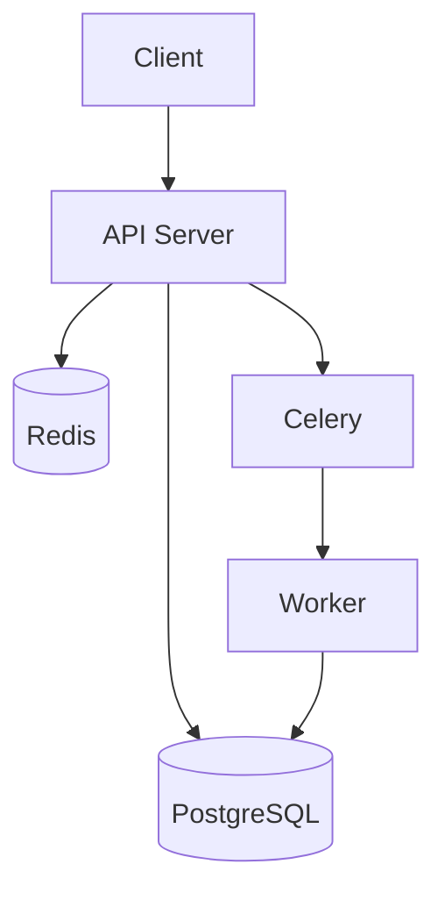

# System Architecture

---

## Overview

---

## Components

| Component | Purpose | Technology |
|-----------|---------|------------|
| API | HTTP endpoints | FastAPI |
| Database | Persistent storage | PostgreSQL |
| Cache | Session/caching | Redis |
| Queue | Async tasks | Celery |

---

## Data Flow

{Describe key data flows}

---

## External Dependencies

| Service | Purpose | Failure Impact |
|---------|---------|----------------|
| {Service} | {Purpose} | {What happens if down} |
