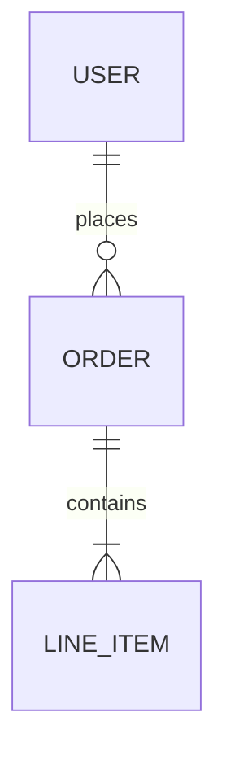

# Database Schema

---

## Entity Relationship Diagram

---

## Tables

| Entity | Table | Description |
|--------|-------|-------------|
| [User](user.md) | `users` | {description} |

---

## Conventions

- Tables: `snake_case`, plural
- Columns: `snake_case`
- Foreign keys: `{table_singular}_id`
- All tables have: `id`, `created_at`, `updated_at`
- Timestamps: UTC
- Money: cents (integer)

---

## Migration Log

| Date | Migration | Description |
|------|-----------|-------------|
| {date} | `{migration_name}` | {Brief description} |

**Migration conventions:**
- **Naming:** `YYYYMMDD_description` (e.g., `20240115_add_user_preferences`)
- **Document:** Complex migrations, breaking changes, data transformations
- **Skip:** Simple column additions, auto-generated boilerplate
